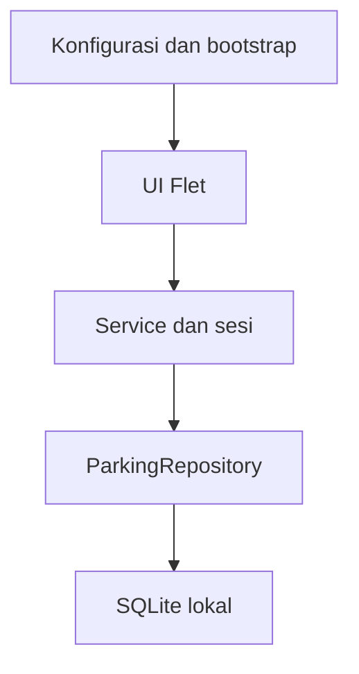

# Desain QPark final

QPark memakai Python 3.10+ dengan Flet 1.0.2 dan SQLite file persisten. Versi pengujian adalah Python 3.12.14. Seluruh operasi mengikuti SRS v1.0: satu lokasi, dua jenis kendaraan, satu operator pada satu waktu, dan tunai.

## Pemisahan lapisan

`app/main.py` memanggil `load_config` dan `create_repository`, lalu menyuntikkan kontrak repository ke `ParkingApp`. UI hanya memanggil service. Service mengenal `ParkingRepository` dan model domain; tidak mengimpor Flet maupun SQLite. Pemilihan backend hanya berada pada `app/bootstrap.py`. Pengelolaan skema/seed bukan tanggung jawab UI.

Empat tabel: users, tarif_parkir, kapasitas_parkir, dan transaksi_parkir. Jenis serta petugas dirujuk melalui foreign key. Tidak ada tabel penghitung slot; jumlah terisi dihitung dari transaksi Aktif. Nomor polisi disimpan dalam bentuk kapital tanpa spasi dan dibatasi 3–12 karakter ASCII huruf/angka.

## Sesi dan otorisasi

AuthService mengaktifkan sesi setelah login benar. Service berbagi registry sesi lokal untuk instance repository yang sama; logout mencabut sesi tersebut. Setiap operasi terlindungi mengecek registry, membaca ulang status akun, lalu memeriksa peran. UI membersihkan form ketika logout dan meminta konfirmasi bila ada isian belum disimpan. Registry ini khusus proses desktop lokal, bukan sistem token autentikasi jaringan.

Repository mengecek ulang status petugas di dalam transaksi simpan masuk dan bayar. Akun hanya dinonaktifkan, tidak dihapus. Hash memakai PBKDF2-HMAC-SHA256 dengan 600.000 iterasi dan salt acak 16 byte. Query nilai pengguna memakai parameter SQL.

## Konsistensi transaksi

- `BEGIN IMMEDIATE` mengunci jalur tulis sebelum pemeriksaan dan perubahan.
- Partial unique index melarang pelat ganda aktif lintas jenis kendaraan.
- Trigger kapasitas memblokir parkir penuh dan penurunan kapasitas di bawah jumlah aktif.
- CHECK mengikat status Aktif/Belum Bayar atau Selesai/Lunas beserta kelengkapan nilai pembayaran.
- UPDATE pembayaran bersyarat `status_parkir='Aktif'` mencegah pembayaran ganda.
- Pembacaan baris bukti dilakukan sebelum commit; gagal baca/serialize domain ikut membatalkan perubahan.
- Trigger melarang ubah/hapus transaksi selesai dan perubahan data masuk pada transaksi yang telah tercatat.
- Tarif disalin saat masuk. Jam tertagih = max(1, ceil(durasi/3600)); nilai uang merupakan integer rupiah.
- Quote dihitung ulang pada konfirmasi. Selisih total menghasilkan PriceChangedError tanpa menulis pembayaran. UI menampilkan total/kembalian baru dan meminta persetujuan lagi.

Sumber waktu lokal menggunakan `datetime.now()` dengan presisi mikrodetik; pengguna tidak memilih waktu masuk/keluar. Clock dapat diinjeksi dalam tes supaya batas 0/60/61 menit diuji deterministik. Jam komputer harus benar dan tidak diubah selama operasi. Tanggal filter lokal mencakup 00:00:00 hingga 23:59:59.999999.

## Antarmuka

Enam halaman: login, beranda, kendaraan masuk, keluar/pembayaran, riwayat, pengaturan. Palet hijau, aksen teal, latar lembut, teks gelap, dan warna status dipusatkan di `app/ui/common.py`. Status memiliki ikon dan tulisan; warna bukan satu-satunya pembeda. Sidebar 220 piksel, isi responsif dengan scroll vertikal; tabel boleh scroll horizontal. Target jendela 1366×768, minimum 1024×650. Keterbacaan render Windows tetap harus diverifikasi secara manual.

Callback async yang dibungkus `ParkingApp.action` memastikan exception dilaporkan. Form masuk/pembayaran/akun memiliki pengaman proses; pembayaran membekukan nominal saat dialog dibuka. Error database menghapus kartu slot/hasil lama dan menampilkan pesan, bukan slot tersedia palsu.

## Penyimpanan

Konfigurasi opsional `.env`: `DB_BACKEND=sqlite`, `SQLITE_PATH=data/qpark.db`. Path relatif terhadap folder proyek. Operasi database menggunakan koneksi singkat dan menutupnya di finally. Skema diinisialisasi secara atomik. Seed awal tidak menimpa akun, tarif, kapasitas, atau status petugas lama.

Database tidak disertakan dalam ZIP. Untuk cadangan, tutup aplikasi lalu salin `data/qpark.db`. Jangan menghapus database untuk memperbaiki launcher; kedua hal tersebut terpisah.
